 

# ⚔️ Kaneki Ken

### Full-Stack Developer • Discord Bot Engineer • Game Systems & Automation

*“A tarnished who keeps building.”*

---

## 🗡️ About Me

I'm a developer who enjoys building systems that solve practical problems — from complex Discord automation and full-stack dashboards to image recognition engines and interactive game environments.

I focus on performance, system architecture, automation, and creating software that can scale beyond a simple prototype.

- 🤖 Building advanced Discord bots, raid automation, moderation systems, and server-management tools.
- 🎮 Developing **OUTBREAK: THE LAST DAYS**, a first-person zombie survival game powered by Three.js and Rapier.
- 🔎 Exploring image recognition, perceptual hashing, image processing, and cache-driven recognition systems.
- 🌐 Building full-stack applications, REST APIs, Discord OAuth2 integrations, and real-time dashboards.
- ⚙️ Working with asynchronous systems, concurrency, database optimization, and reliable deployments.
- 🧊 Experimenting with 3D assets, Blender workflows, FBX models, and game development pipelines.

## 🛠️ Tech Stack

**Languages**

**Backend, Frameworks & APIs**

**Game Development & Image Processing**

**Databases & Infrastructure**

**Development & Deployment**

## 🏰 Featured Projects

### 🎮 [OUTBREAK: THE LAST DAYS](https://github.com/Kaneki-Ken5454/OutBreak-The-Last-Days)

**First-Person Zombie Survival • Three.js • Rapier • TypeScript**

An ambitious first-person zombie survival game set in a world devastated by an ancient pathogen released by melting glaciers.

- First-person gameplay with Three.js rendering and Rapier physics.
- Campaign progression, missions, enemies, weapons, and survival systems.
- SafeHouse development, crafting, resources, and progression mechanics.
- Horde mode with escalating zombie waves and base-defense systems.
- Backend-authoritative architecture for persistent player state and game commands.
- Discord Activity integration as the intended game platform.

*Currently in active development.*

### 🤖 [AutoSender II](https://github.com/Kaneki-Ken5454/AutoSender-Reduced-)

**Discord Raid Automation • Python • PostgreSQL • Async Systems**

A database-backed raid aggregation and automated delivery system designed to manage raid workflows across Discord servers.

- Automatic raid discovery and embed processing.
- Eligibility evaluation using participation, roles, and raid requirements.
- Scheduler-driven raid delivery and cooldown management.
- Centralized send queue with pacing and retry handling.
- Global raid board, participation tracking, and leaderboard statistics.
- Diagnostics, performance metrics, and administrative controls.

### 🧩 [Homunculus](https://github.com/Kaneki-Ken5454/Homunculus-)

**Discord Bot • Full-Stack Dashboard • React • Node.js**

A Discord bot ecosystem paired with a web-based server management dashboard.

- Discord OAuth2 authentication and server administration.
- Moderation, warnings, tickets, and audit history.
- Custom commands, triggers, autoresponders, and reaction roles.
- Real-time dashboard updates using WebSockets.
- Member management, analytics, and administrative controls.
- Shared database architecture between the bot and dashboard.

**Related:** [Homunculus Dashboard](https://github.com/Kaneki-Ken5454/Dashboard-Homunculus)

### 🔎 [Xypher](https://github.com/Kaneki-Ken5454/Xypher)

**Pokémon Image Recognition • Image Processing • Caching**

An image-recognition project focused on identifying Pokémon from game screenshots efficiently.

- Perceptual hashing and image similarity detection.
- Image preprocessing, blur-resistant matching, and hash comparison.
- Recognition caching and multi-stage lookup workflows.
- Optimizing recognition speed for high-volume image processing.
- Reducing false matches between visually similar Pokémon.

---

## ⚙️ Engineering Interests

- **Backend Engineering:** API architecture, database design, asynchronous processing, and service integration.
- **Discord Engineering:** Bot architecture, event handling, permissions, rate limits, and server automation.
- **Performance Engineering:** Concurrency control, caching, resource optimization, and efficient processing.
- **Computer Vision:** Perceptual hashing, image preprocessing, similarity matching, and recognition pipelines.
- **Game Development:** First-person systems, movement physics, combat mechanics, enemy AI, and progression.
- **Real-Time Systems:** WebSockets, synchronized state, event-driven workflows, and live dashboards.
- **3D Development:** Blender, FBX asset integration, character models, animations, and game environments.

## 📊 GitHub Statistics

<!-- Generated by .github/workflows/update-stats.yml -->

  

## 📫 Find Me

- **GitHub:** [Kaneki-Ken5454](https://github.com/Kaneki-Ken5454)
- **Discord:** `kaneki_ken5454`
- **Nameplate:** [nameplate.lol/kaneki_ken](https://nameplate.lol/kaneki_ken)

---

Forged through curiosity, persistence, and a little Tarnished determination.

**⚔️ Keep building. Keep evolving.**

